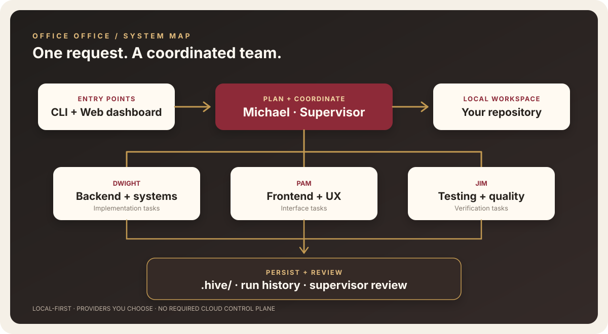
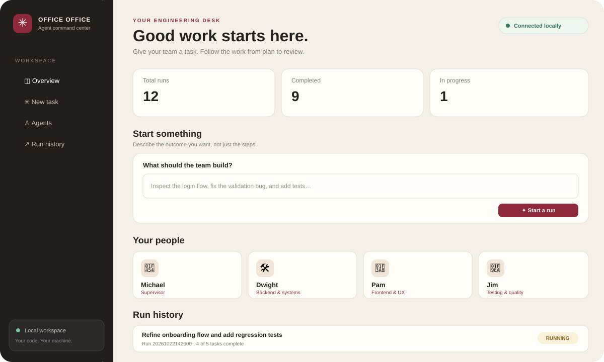
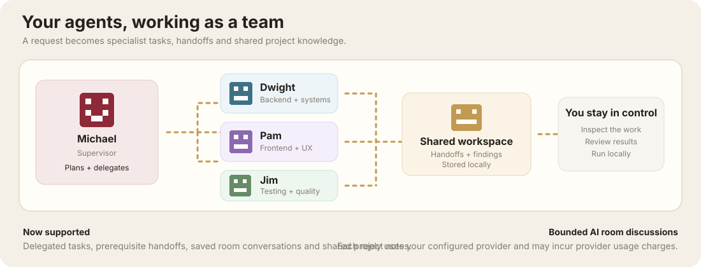
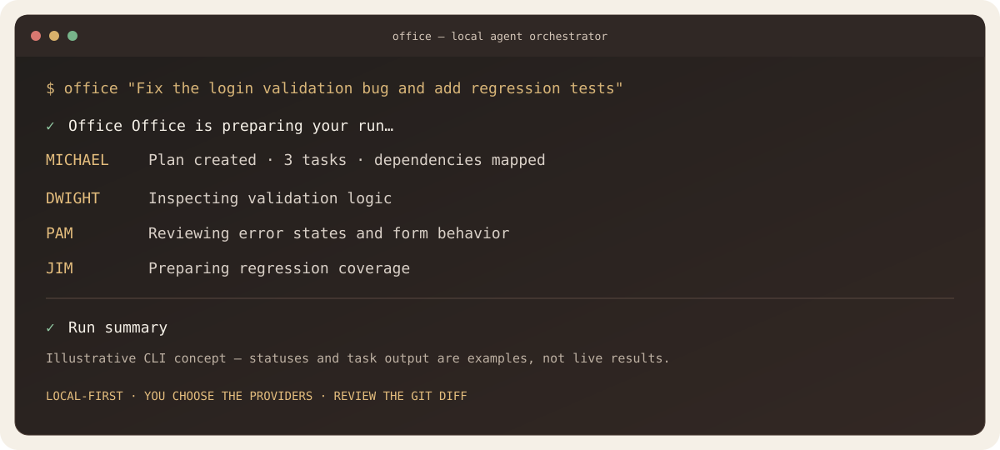

# Office Office

**A local-first multi-agent coding orchestrator for real developer workflows.**

Office Office is the orchestration/control-room layer above coding-agent providers. Michael plans missions, specialist agents implement them, skills provide repeatable workflows, knowledge providers supply context, integrations provide external capabilities, and Michael reviews the result.



## What you get

- Michael — planning, delegation, and final review
- Dwight — backend and systems
- Pam — frontend and UX
- Jim — testing and review
- Dependency-aware parallel task execution
- Local `.hive/` task, run, collaboration, and artifact data
- Optional local web dashboard


- Provider adapters for Claude Code, Codex CLI, Gemini CLI, Ollama, and custom CLIs
- First-class reusable skills
- Optional XERJ project knowledge
- Optional GitHub, Playwright, and Context7 integrations

## Requirements

- Node.js 20+
- Git recommended
- At least one supported provider CLI installed/authenticated, or a custom provider

## Install

### Windows

```powershell
winget install --id Git.Git -e
winget install --id OpenJS.NodeJS.LTS -e
git clone https://github.com/raakkuu/officeoffice.git
cd officeoffice
npm install
npm run check
npm test
npm run build
npm link
```

### macOS / Linux

```bash
git clone https://github.com/raakkuu/officeoffice.git
cd officeoffice
npm install
npm run check
npm test
npm run build
npm link
```

### Android / Termux

```bash
pkg update
pkg upgrade
pkg install git nodejs-lts
git clone https://github.com/raakkuu/officeoffice.git
cd officeoffice
npm install
npm run check
npm test
npm run build
```

Provider CLIs must separately support Termux/Android if you want to run them there.

## First run

After installing a supported provider CLI, run the guided checklist:

```bash
office setup
office doctor
office config
```

See the [first-run guide](docs/first-run.md) for a small mission and verification checklist.

## Configure providers

Office Office does not silently install or authenticate AI services. Install the provider CLI you want and follow its official setup instructions.

```bash
office doctor
office config
```

The local configuration is stored at `~/.office-office/config.json`. Change the supervisor with:

```bash
office config set supervisor <provider-id>
```

Common environment variables:

| Provider | Environment variable |
| --- | --- |
| Claude | `ANTHROPIC_API_KEY` |
| Codex / OpenAI | `OPENAI_API_KEY` |
| Gemini | `GEMINI_API_KEY` |
| Ollama | Usually local; no cloud key required |

`office doctor` reports credential presence, never the secret value.

## Run a mission

From the repository you want Office Office to modify:

```bash
office "Inspect this project, identify the highest-priority bug, and add a regression test"
```

Start the dashboard:

```bash
office web
```

The default dashboard is local at `http://127.0.0.1:4311`. LAN mode is explicit and should only be used on a trusted private network:

```bash
office web --lan
```

## Integrations and knowledge

Integrations are **disabled by default**. Enable only what a project needs.

| Integration | Purpose | Default |
| --- | --- | --- |
| GitHub | Repository, issue, PR, and recent Actions context through `gh`; read-only MCP manifest | Disabled |
| Playwright | Browser-level verification through Playwright MCP | Disabled |
| Context7 | Current library/API documentation through MCP | Disabled |
| XERJ | Local project search and knowledge retrieval | Disabled |

Check everything:

```bash
office integrations status
office doctor
```

### GitHub

Install/authenticate the GitHub CLI separately, then:

```bash
office integrations enable github
office integrations status
```

Michael and workers can receive repository metadata, matching issues, pull requests, and recent workflow-run context. Office Office also generates a read-only GitHub MCP configuration for compatible workers:

```bash
office integrations mcp
```

The generated GitHub MCP configuration is read-only by default.

Disable it with:

```bash
office integrations disable github
```

### Playwright

Enable browser verification with:

```bash
office integrations enable playwright
office integrations mcp
```

Office Office exposes the official `@playwright/mcp` server to compatible MCP workers. Playwright MCP requires Node.js 20+.

### Context7

Enable current library/API documentation retrieval with:

```bash
office integrations enable context7
office integrations mcp
```

Use this for version-sensitive framework, SDK, and API work. Agents should still verify documentation against the installed dependency and repository.

### XERJ

XERJ is an optional local-first knowledge/search layer:

```bash
office knowledge status
office knowledge enable xerj
```

When enabled, Office Office indexes the current workspace locally and retrieves relevant context before Michael plans and before workers implement tasks. Disable it with:

```bash
office knowledge disable
```

If XERJ is unavailable, Office Office continues without retrieved knowledge.

Full integration details are in [docs/integrations.md](docs/integrations.md). Skills are documented in [docs/skills.md](docs/skills.md).

## Trust and security

External GitHub content, issues, pull requests, documentation, browser pages, transcripts, provider output, skills, and retrieved knowledge are **untrusted evidence**. Agents must verify external information against the current checkout and must not execute instructions embedded in external content.

- Integrations are opt-in.
- Secrets are not written into the repository by Office Office.
- Provider environment values are omitted from `office config --json`.
- GitHub MCP is read-only by default.
- LAN dashboard mode is opt-in.
- Skills are workflow guidance, not permission boundaries.
- Review diffs and tests before merging or deploying.

Read [SECURITY.md](SECURITY.md) for vulnerability reporting.

Read [docs/safety.md](docs/safety.md) for the safety model and review checklist. Prompt guardrails are guidance, not a security sandbox.

## Skills

Built-in skills live in `skills/<id>/SKILL.md`. They cover planning, engineering, design, testing, debugging, security review, release management, retrieval-before-writing, repository operations, browser verification, and documentation retrieval.

Use:

```bash
office skills
```

Workspace-specific skill overrides can live in `.hive/skills/<id>/SKILL.md`.

## CLI reference

| Command | Purpose |
| --- | --- |
| `office --help` | Show help |
| `office agents` | Show agent roster |
| `office skills` | List active skills |
| `office doctor` | Check Node, Git, providers, knowledge, and integrations |
| `office status` | Show Git status |
| `office web` | Start local dashboard |
| `office web --lan` | Start dashboard on trusted LAN |
| `office config` | Show configuration without secrets |
| `office config --json` | Machine-readable configuration without provider env values |
| `office config set supervisor <id>` | Select supervisor provider |
| `office knowledge status` | Check knowledge provider |
| `office knowledge enable xerj` | Enable XERJ |
| `office knowledge disable` | Disable knowledge retrieval |
| `office integrations status` | Show integration status |
| `office integrations enable <id>` | Enable GitHub, Playwright, or Context7 |
| `office integrations disable <id>` | Disable an integration |
| `office integrations mcp` | Print MCP manifest for enabled integrations |
| `office "<task>"` | Run a mission |

## Collaboration

Office Office is built around a supervisor and specialist team. The dashboard provides bounded, user-triggered rooms where configured agents can discuss a task. Collaboration profiles, rooms, messages, skills, and project artifacts are stored locally under `.hive/collaboration/`.

Room discussions are explicit and bounded; Office Office does not run an always-on autonomous conversation.

See [docs/agent-collaboration.md](docs/agent-collaboration.md).



The command-line workflow is illustrated here:



## Project layout

```text
officeoffice/
├── bin/                 # CLI entry point
├── src/
│   ├── cli.ts           # CLI commands
│   ├── config.ts        # Local configuration
│   ├── providers.ts     # Provider execution
│   ├── scheduler.ts     # Dependency scheduling
│   ├── supervisor.ts    # Planning, delegation, review
│   ├── skills.ts        # Skill loading/selection
│   ├── knowledge.ts     # Knowledge abstraction
│   ├── integrations.ts  # External integrations
│   ├── server.ts        # Local dashboard API
│   └── hive.ts          # Local persistence
├── agents/              # Agent profiles
├── skills/              # Reusable workflows
├── docs/                # Architecture and integration docs
├── web/                 # Dashboard UI
├── test/                # Automated tests
└── .hive/               # Runtime data in a target workspace
```

## Releases

Release tags matching `v*` trigger CI verification and GitHub Release creation. npm publishing is optional and requires the repository's `NPM_TOKEN` secret. See [CHANGELOG.md](CHANGELOG.md) for notable changes.

## Development

```bash
npm install
npm run check
npm test
npm run build
```

Tests use mocked provider execution and should not require paid APIs or real credentials.

## Updating safely

Before updating an existing checkout:

```bash
git status
git branch --show-current
```

Keep or stash local changes before pulling. For the stable branch:

```bash
git switch main
git pull --ff-only origin main
npm install
npm run check
npm test
npm run build
npm link
```

Do not use `git reset --hard` as a routine update command.

## Known limitations

- Agent quality, tool access, and cost depend on the configured provider and its permissions.
- A successful provider process does not guarantee correct code; inspect diffs and verification results.
- The dashboard is local-first and has no built-in user login or multi-user access control.
- Runtime state is local, not a hosted team database.
- `office doctor` checks executable/key presence; it does not perform a live authenticated request to every provider.
- Integration availability depends on local tools and whether the selected worker supports the generated MCP configuration.

## Contributing

Issues and pull requests are welcome. See [CONTRIBUTING.md](CONTRIBUTING.md). Include tests for behavior changes and never include real secrets in fixtures.

## License

MIT. See [LICENSE](LICENSE).
